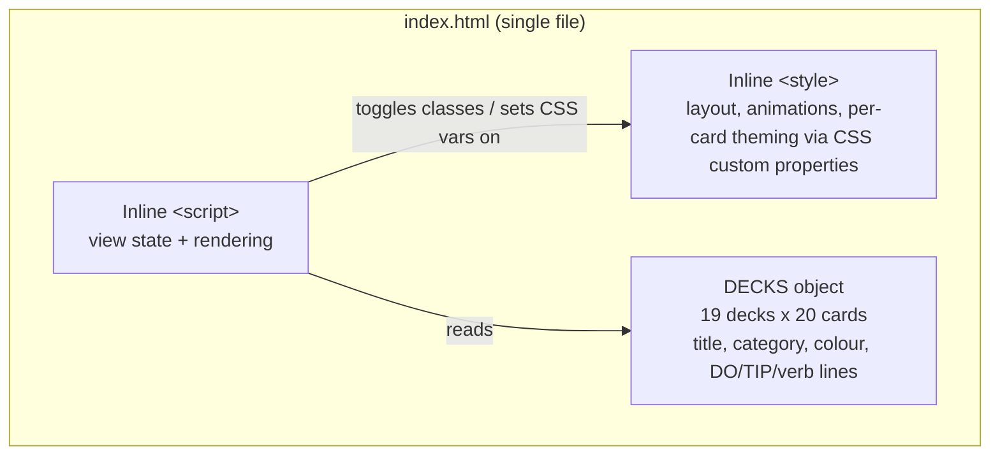
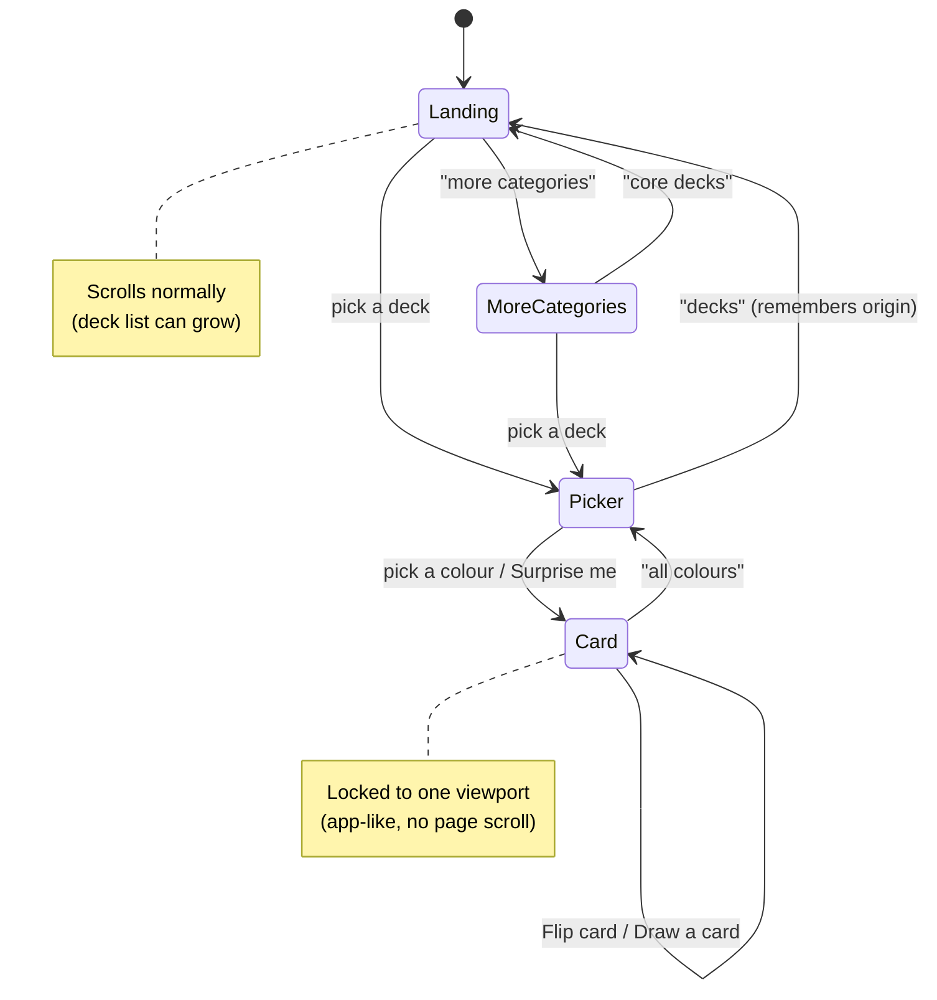
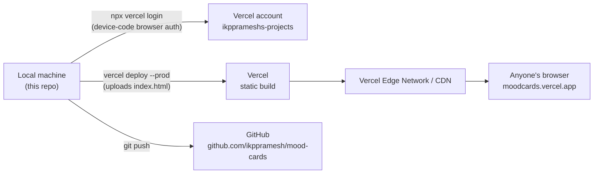

# Mood Cards

An interactive, animated web recreation of [The Mood Club](https://themoodclub.com)'s physical "Mood Cards" — pick a deck for the moment you're in, pick a colour that matches how you feel, and flip the card for a quick, practical activity to try right now.

**Live app:** https://moodcards.vercel.app
**Vercel project:** https://vercel.com/ikpprameshs-projects/mood-cards

---

## What this is

The Mood Club sells small tins of mood-boosting activity cards — each card has a title on the front and a `DO / TIP / <verb>` activity on the back, colour-coded by theme. This project turns that idea into a single-page web app:

- **19 decks, 380 cards total.** Three decks (`for me`, `for work`, `for me and you`) are recreated from the real products, using genuine card titles and instructional text sourced from product photography where available. The other sixteen decks (Sleep, Calm, Family, Friends, Students, Money, Fitness, Career Change, Grief, and more) are originally written in the same `DO / TIP / <verb>` format and tone.
- **A three-step flow:** choose a deck → pick a colour (or hit "Surprise me") → read and flip the card.
- **A rainbow, animated colour-picker screen**, a 3D card-flip interaction, a stacked "deck of cards" visual, and a bold colour-matched background once a card is chosen.
- **No backend, no build step, no framework.** It's one static `index.html` file with inline CSS and JavaScript — all 380 cards' data lives in a single JS object.

## Features

- 6 "core" decks on the landing page, plus a "more categories" screen for the other 13
- Colour picker per deck, with the swatches derived from each card's own colour
- Card flip animation (front: title + category; back: DO/TIP/activity)
- "Draw a card" (random) and "Flip card" controls
- Fully responsive — the card/colour-picker screens lock to one viewport (an app-like feel), while the deck-browsing screens scroll normally as the list of decks grows
- Zero dependencies beyond a Google Fonts import (Fredoka + Nunito)

## Try it locally

No build step — just open the file:

```bash
open index.html
```

or serve it if you prefer:

```bash
npx serve .
```

## Architecture

This is intentionally as simple as a web app gets: one HTML file, no server, no database. All "state" is a handful of JavaScript variables held in the browser tab; nothing is persisted or sent anywhere.

### App structure (inside `index.html`)



### Screen flow (user-facing state machine)



## Deployment

The app is deployed directly to Vercel as a static site — no CI/CD pipeline, no GitHub integration configured (this repo is for source control / history; deploys are pushed manually via the Vercel CLI).



**How it was set up**, for reference:

1. Logged into the Vercel CLI against the `ikpprameshs-projects` team using the device-authorization flow (`vercel login`, approved in the browser).
2. Deployed with `vercel deploy --scope ikpprameshs-projects --yes --prod`, which auto-created the `mood-cards` project on first deploy.
3. **Caught and fixed a mistake on the first deploy:** it initially uploaded the whole project folder, including a local subfolder of personal reference photos, briefly exposing them at predictable URLs. Fixed by adding `.vercelignore` (excludes that folder and `.DS_Store`), redeploying, and deleting the old exposed deployment.
4. Every subsequent change is redeployed with the same `vercel deploy --prod` command from this folder.

The production alias is `moodcards.vercel.app` (with `mood-cards.vercel.app` redirecting to it).

## Project structure

```
Mood/
├── index.html     # the entire app — markup, styles, data, logic
├── .vercelignore  # excludes local-only files from deployment
├── .gitignore
└── README.md
```

## Credits

Concept, colour system, and card format inspired by [The Mood Club](https://themoodclub.com)'s physical Mood Cards product line (`for me`, `for work`, and `for me and you`). This project is a fan-made, non-commercial recreation for personal use.
